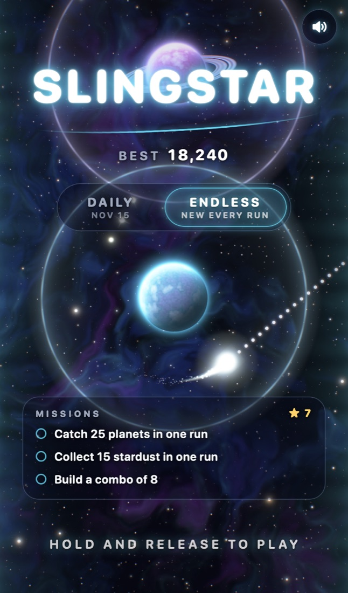
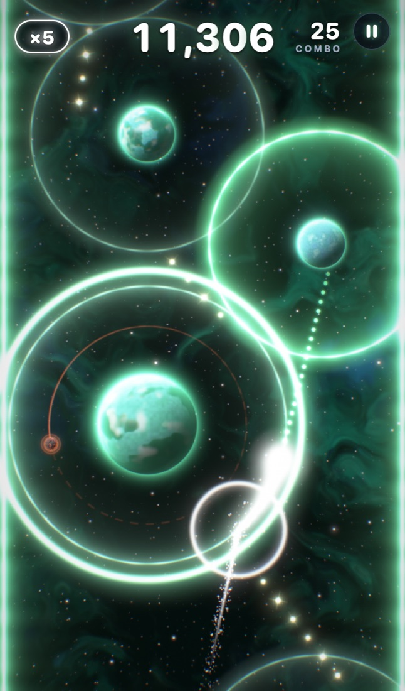
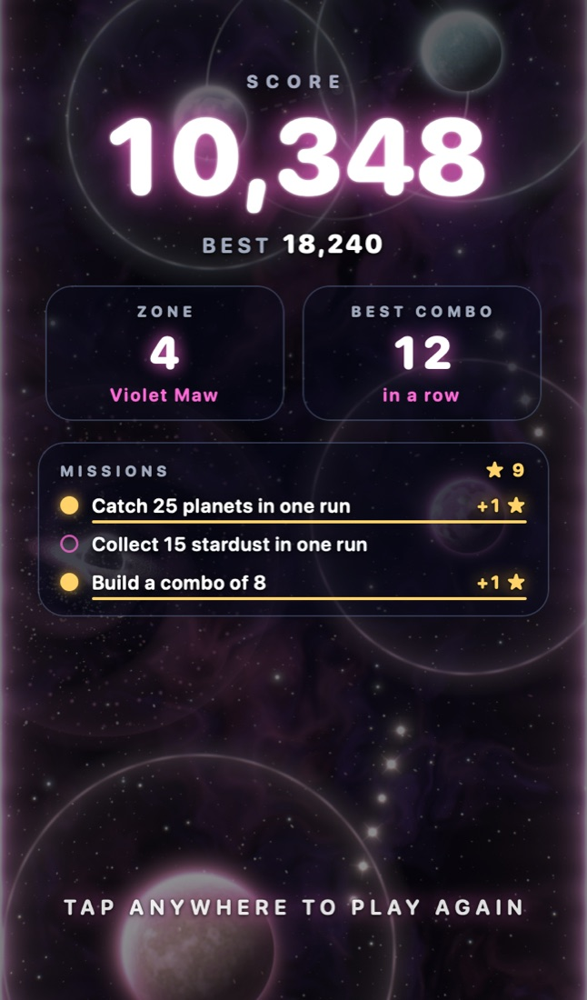

# Slingstar

### ▶ Play: https://firstprateek.github.io/slingstar/

<p align="center">
  
  
  
</p>

A one-thumb orbital slingshot game for the phone and the browser. The comet climbs an endless field
of planets: hold to latch into orbit, release to fling off along the tangent, catch the next
planet, and stay ahead of the wall of light rising from below.

It is a static web app: plain JavaScript ES modules, raw WebGL2, synthesised WebAudio, no build
step and no runtime dependencies. It runs in any current desktop or mobile browser with WebGL2,
installs to the iPhone home screen from Safari and works offline.

## How to play

- **The whole screen is the button.** Hold inside a planet's capture ring to orbit it; let go to
  fly off in a straight line along the dotted aim line. On a computer, hold the mouse button
  (anywhere in the window) or the space bar. Space or Enter also plays again after a run; Escape or
  P pauses. Wide windows show the game in a centred portrait column, so you see as far ahead as
  on a phone, with a how-to-play card beside it.
- Press early and the hold stays armed: the comet latches the moment it enters a ring.
- The aim line lights up in the zone's colour when releasing now would reach the next planet.
- Orbits slowly decay. Hold too long and you crash into the planet.
- **Brace:** flying into a planet, moon or black-hole core is not the end. Press within 0.2 s of
  the hit (just before or just after) and the comet braces: it bounces off, loses a tenth of its
  size and the combo resets. The hull meter shows the braces left (5 from full size); stardust
  slowly regrows it. Miss the window, or brace with an empty hull, and the run ends.
- Catching new planets builds your combo and multiplier (×1 to ×5). Bouncing off a side wall,
  re-catching the planet you just left, or lingering more than 2.5 laps resets it.
- Graze close to a surface, collect stardust and slingshot past black holes for extra points.
- Every 10 planets is a new zone with a new hazard: moons, drifting planets, black holes and
  binary pairs.
- **Missions:** three short goals at a time (catch 15 planets in one run, reach zone 4, collect
  stardust, slingshot a black hole...). Each one finished earns a star and is swapped for a new,
  slightly harder goal at the start of the next run. Progress and stars stay on the device.
- **Daily** plays the same course for everyone on a given date; **Endless** is a new course every
  run. Best scores are kept per mode (per date for Daily).
- The pause button (top right) has Resume, Restart, the sound toggle, the build version and a
  Reload button (a home-screen app has no browser reload).

## Add it to the iPhone home screen

1. Open https://firstprateek.github.io/slingstar/ (or your own deploy's HTTPS address) in
   **Safari** on the iPhone.
2. Tap **Share**, then **Add to Home Screen**, then **Add**.
3. Launch it from the new icon. It runs full-screen in portrait and keeps working offline.

To pick up a new version, open the game, tap pause, then **Reload**.

**Sound:** the iPhone's silent (ring/silent) switch mutes web audio. That is expected: flip the
switch to hear the game. The game uses an "ambient" audio session where Safari supports it, so
music from other apps keeps playing alongside it. With sound turned off in the game, no audio
runs at all.

## Development

**Next steps** (steer, refill power-ups, difficulty modes and smaller follow-ups) are in
[`docs/ROADMAP.md`](docs/ROADMAP.md), with design notes, constraints and how to land a change.

Requirements: Node.js (any current release) and `npm install` for the two dev dependencies
(Playwright for WebKit tests, TypeScript for type checks). Nothing in `node_modules/` ships.

| Command | What it does |
|---|---|
| `npm test` | Node's test runner over `tests/`: determinism, generator solvability, fairness and human-like bots, rules, hazards, purity of `src/sim/` |
| `npm run check` | TypeScript `checkJs` over the JSDoc-typed sources (no output files) |
| `npm run serve` | Static server on `http://127.0.0.1:8791` with correct MIME types and `no-cache` on `index.html`, `sw.js` and the manifest. `PORT`, `HOST` and `ROOT` override it |
| `npm run smoke` | Playwright WebKit with an iPhone viewport (390×844, scale 3, touch): boot, autoplay, touch run, pause/resume, late zones. Screenshots go to `artifacts/` |
| `npm run precache` | `tools/build-precache.mjs`: writes the shipped file list and a content-hash version into `sw.js` and `src/version.js`. Run it after changing any shipped file (the smoke test fails if you forget) |
| `npm run icons` | `tools/make-icons.mjs`: renders `icons/icon.svg` to the 180, 192 and 512 px PNGs |

Other tools: `node tools/tune.mjs [seeds]` prints bot statistics that `src/config.js` is tuned
against; `node tools/shell-check.mjs` drives the UI demo page (`src/ui/demo.html`). Dev pages
`src/render/demo.html`, `src/audio/test.html` and `src/ui/demo.html` are served by `npm run serve`
but never shipped.

### URL parameters

They work in the shipped build too.

| Parameter | Effect |
|---|---|
| `?debug=1` | Overlay with frame time, sim time, draw calls, live particles and render scale |
| `?seed=N` | Fix the course seed (otherwise Daily uses the date and Endless is random) |
| `?autoplay=1` | The fairness bot plays and restarts on its own |
| `?fast=N` | With `?autoplay=1`: run the simulation N× real time (up to 8) |
| `?landscape=1` | Treat a desktop browser as a phone for the "rotate your phone" overlay |

`window.__slingstar` exposes the live world state, current screen, renderer stats and version for
tests.

### Project layout

```
index.html  manifest.webmanifest  sw.js       entry page, PWA manifest, service worker
css/app.css                                 HUD, screens and overlays
icons/                                      icon.svg and its PNG renders
src/main.js                                 boot, screen state machine, fixed-step frame loop
src/config.js                               every tuning constant
src/contracts.js                            JSDoc types shared between modules
src/core/                                   seeded RNG, math, event queue
src/sim/                                    pure deterministic simulation, level generator, bot
src/render/                                 WebGL2 renderer, shaders, bloom, particles
src/audio/                                  WebAudio engine, music scheduler, SFX
src/ui/                                     HUD, screens, debug overlay
src/meta/                                   run missions (pure; progress kept in localStorage)
src/platform/                               input, lifecycle, storage, service worker registration
tests/                                      node --test suites
tools/                                      server, smoke test, precache and icon builders
scripts/deploy.sh                           local deploy for the phone
docs/                                       ROADMAP.md and README screenshots (not shipped in the precache)
```

`src/sim/` never touches the DOM, timers or `Math.random`, so it runs unchanged under Node. The
renderer, audio and HUD only read world state, and the frame loop allocates nothing.

## Deploy

**GitHub Pages** serves the repository root of `main` at https://firstprateek.github.io/slingstar/.
Every path in the app is relative and the service worker is scoped to its own folder, so the same
files work there with no build step. Run `npm run precache` before merging a change to a shipped
file, so the service worker version changes and returning players pick it up.

**Local network:** `scripts/deploy.sh` publishes the game from a Mac to a phone on the same Tailscale network. It
needs `node` and the `tailscale` CLI.

```sh
scripts/deploy.sh --dry-run   # print every step; change nothing
scripts/deploy.sh             # deploy
```

What it changes on the Mac:

1. Runs `tools/build-precache.mjs`, so the service worker version changes and phones update.
2. Copies exactly the shipped files (plus `tools/serve.mjs`) to `~/apps/slingstar`, removing files
   that are no longer shipped. Set `SLINGSTAR_DEST` to use another folder. It refuses to deploy
   inside `~/Documents`: macOS blocks background services from reading it.
3. Writes and (re)loads the launch agent `local.slingstar.server`
   (`~/Library/LaunchAgents/local.slingstar.server.plist`), which runs `node tools/serve.mjs` on
   `127.0.0.1:8791` from the deployed folder, at login and kept alive. Logs go to
   `~/Library/Logs/slingstar-server.log`.
4. Runs `tailscale serve --bg --https=10000 http://127.0.0.1:8791`, exposing the game over HTTPS on
   port 10000 of the Mac's Tailscale name. No other Tailscale Serve port is touched.

It ends by printing the address to open on the phone. The service worker needs HTTPS (or
localhost), which Tailscale Serve provides.

## License

[MIT](LICENSE) © 2026 Prateek Joshi
